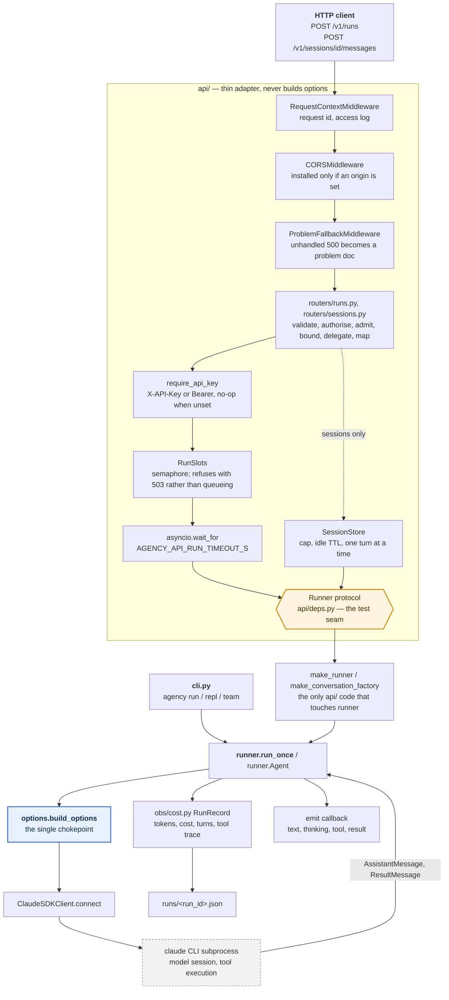
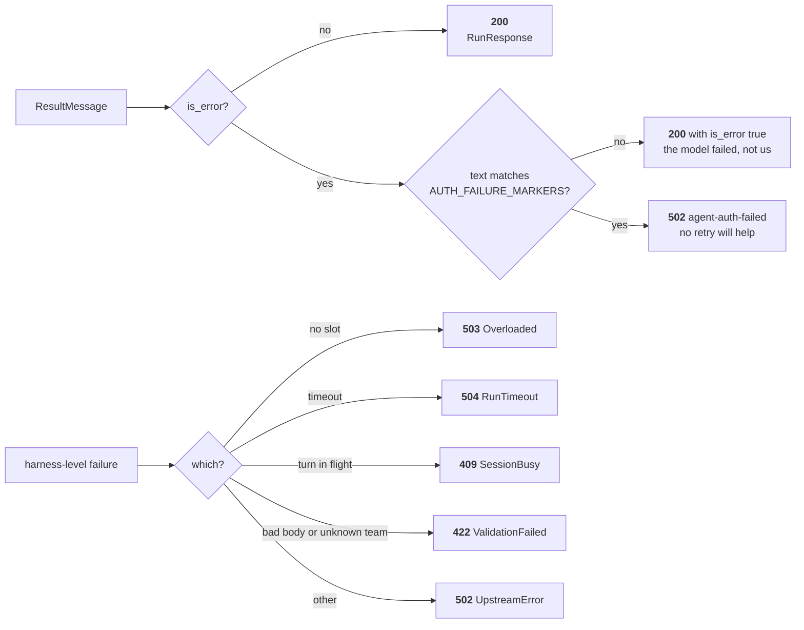
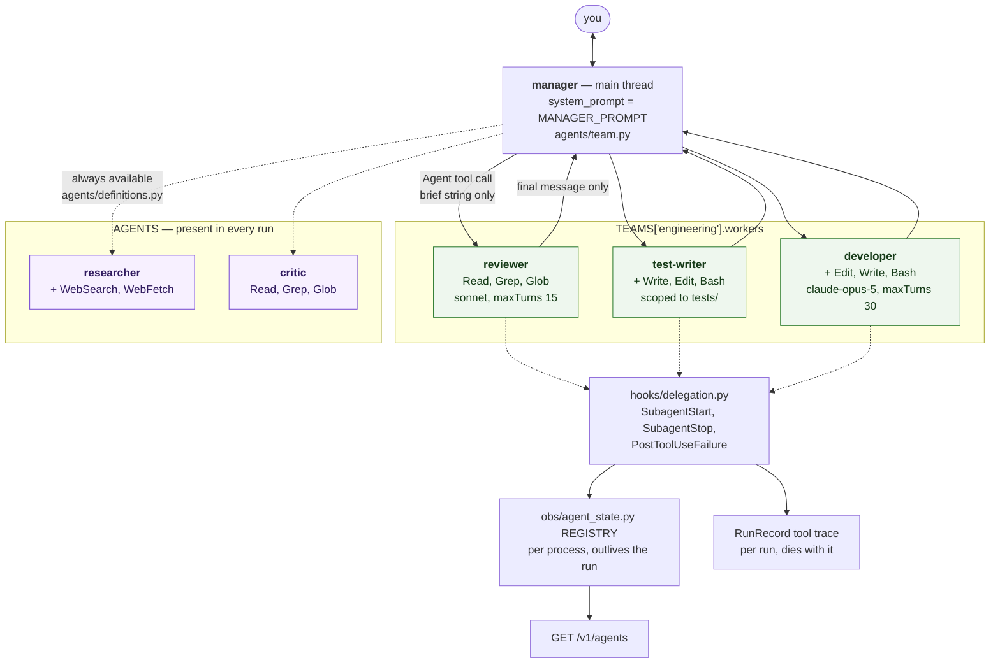
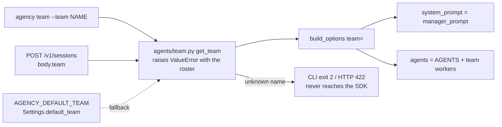
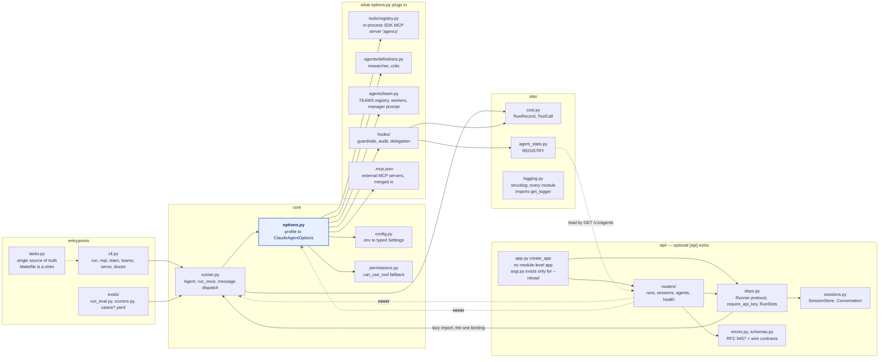
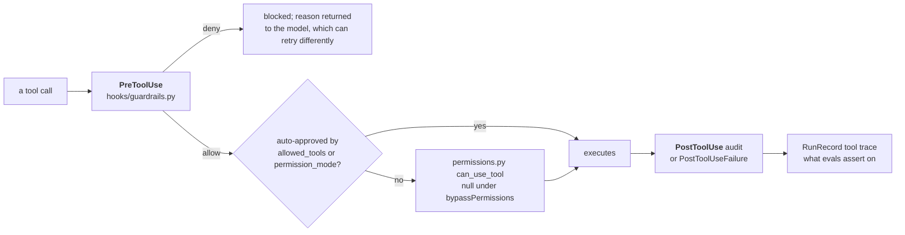
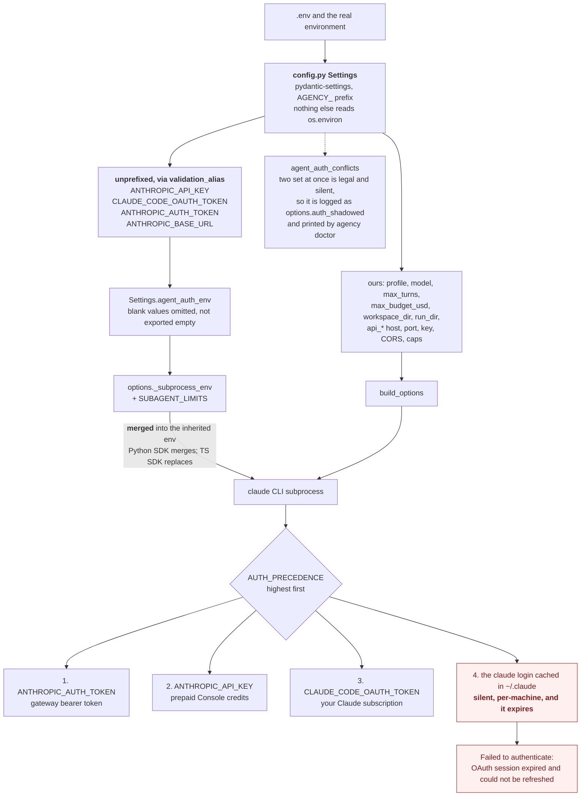
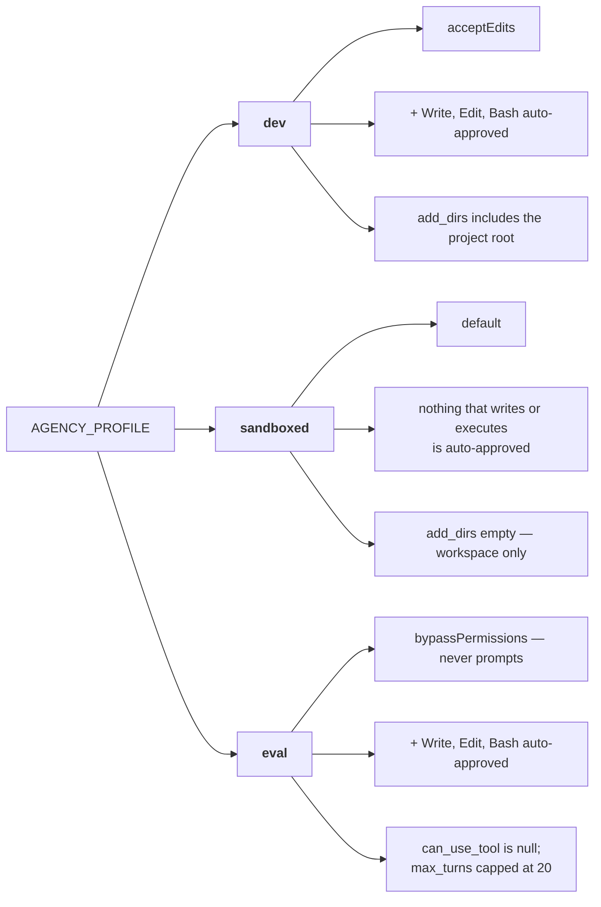

# Architecture

Diagrams of how `agency` fits together. They are Mermaid, so they render in GitHub, in
the VS Code Markdown preview, and anywhere else that speaks Mermaid — and they are text,
so they diff in review like the code they describe.

**Editing.** Change the fenced `mermaid` blocks below. Node ids are stable and
mostly named after the file they represent, so a rename in `src/` should be a
find-and-replace here. Prefer adding a node over adding a diagram: four views is the
budget, and a fifth one nobody updates is worse than none.

**Scope.** These describe the wiring — who calls whom, and what is deliberately not
allowed to. They do not describe behaviour that the docstrings already cover; where a
box hides a subtlety, the caption under the diagram says which file to read.

- [1. What happens when you send a prompt](#1-what-happens-when-you-send-a-prompt)
- [2. Manager and workers](#2-manager-and-workers)
- [3. Module map](#3-module-map)
- [4. Configuration and credentials](#4-configuration-and-credentials)

---

## 1. What happens when you send a prompt

Two entrypoints, one path. The HTTP layer adds admission control, a timeout and error
mapping, then hands off to exactly the code `agency run` uses.

**The two rules this picture enforces.** Nothing under `api/` imports `agency.runner`
or constructs `ClaudeAgentOptions` — routes depend on the `Runner` protocol, and
`make_runner` / `make_conversation_factory` are the only bindings to the real loop. That
is what keeps `options.py` the one place a run is configured once there are two
entrypoints. Tests override the `Runner` dependency and exercise the whole stack — auth,
validation, admission, error mapping — without a model session.

**A session is not a row in a table.** It holds the CLI subprocess open *between*
requests, so every exit path (`DELETE`, a failed turn, the idle reaper, shutdown) goes
through `SessionStore.close`; `api/deps.py::_AgentConversation._kill_if_orphaned` is the
synchronous backstop for a teardown that gets cancelled mid-await.

### How a failure is classified

The distinction the status codes exist to preserve: the agent failing is not the harness
failing.

Every one of these is an `APIError` subclass rendered as an RFC 9457
`application/problem+json` document, including 404s from unknown routes and FastAPI's
own 422s. See `api/errors.py`; the markers themselves live in `obs/cost.py`.

---

## 2. Manager and workers

The mental model that matters: **the manager is not a subagent**. It is the main-thread
agent — the one you talk to. Workers exist only inside `Agent` tool calls.

**Why the boundary works.** A worker gets a fresh context window: it inherits no
history, no tool results, and not the manager's system prompt. Three consequences —

1. **Context isolation.** A worker can read forty files; the manager sees one paragraph.
   This is the only thing keeping a long session from drowning in tool output.
2. **The brief is the entire interface.** A vague brief produces a worker that guesses.
3. **Least privilege is per-worker.** `tools=[...]` is not advisory — `reviewer`
   physically cannot write a file.

**Three wiring traps, each of which looks like a model-quality problem.**

- Both `"Task"` and `"Agent"` must be in `allowed_tools`. The tool was renamed
  Task → Agent in Claude Code v2.1.63; SDKs emit `Agent` in tool_use blocks but still
  report `Task` in the `system:init` list. List only one and delegation falls through to
  `can_use_tool` and stalls on a prompt — indistinguishable from "the model won't
  delegate".
- `AgentDefinition` fields are camelCase (`maxTurns`); `ClaudeAgentOptions` is
  snake_case. Wrong casing is an ignored field, silently.
- `MANAGER_PROMPT` is the routing table. A worker in `TEAM` but not named in that prompt
  is unreachable, with no error anywhere. `test_manager_prompt_advertises_every_worker`
  is the guard.

The tree is capped in `options.SUBAGENT_LIMITS`: spawn depth 1 (workers cannot spawn
workers), concurrency 4. Enforced by the CLI, not by prompt wording.

### Where a team gets selected

Adding a team is one entry in `TEAMS`. Nothing else hard-codes a team name — the CLI's
`agency teams`, `build_options`, and `GET /v1/agents` all read that registry.

---

## 3. Module map

Arrows are imports, reading left to right: entrypoints call the core, the core plugs in
everything else. The red `never` edges are conventions the codebase depends on and the
type checker does not enforce.

**Read this as two rules.** `options.py` is the only place `ClaudeAgentOptions` is
constructed — config drift between CLI, tests and evals is the main way an agent harness
stops being reproducible. And `api/` reaches the loop through one lazy import in
`deps.py`, so adding a second entrypoint did not add a second way to configure a run.

`setting_sources=[]` is deliberate: the agent inherits no ambient user or project
settings, so it behaves the same on every machine and in CI.

### Hook and permission layers

Both exist because they see different things.

The asymmetry is the point: `can_use_tool` never sees an auto-approved call, so hard
blocks — destructive Bash patterns, writes outside the workspace, reads of `.env` and
key files — live in the `PreToolUse` hook, where they hold no matter how permissive the
profile is. The container is the real boundary; this is the in-process layer.

---

## 4. Configuration and credentials

The subtlety worth a diagram: **the agent's credentials are not this app's
credentials**. The SDK spawns the Claude Code CLI, and that process authenticates from
*its own* environment.

**The failure this shapes.** A key that lives only in `.env` reaches `Settings` but not
the subprocess unless it is declared here — so the CLI falls back to the cached login,
and the run dies naming a credential nobody chose. Docker hid it, because
`compose.yaml` injects `ANTHROPIC_API_KEY` explicitly; only native runs were affected.
The precedence is a copy of the CLI's own rule, not a policy of ours: if `agency` picked
a different winner than a bare `claude` on the same machine, the harness would stop
being a faithful way to reproduce what the CLI does.

`python tasks.py doctor` prints which mode is active, and where the billing lands.

### What a profile changes

Orchestration and policy are orthogonal: a manager running under `sandboxed` is still
sandboxed, and so is every worker it spawns. `KillShell` is disallowed in every profile.
The guardrail hook runs in all three — profile changes what is *auto-approved*, never
what is *blocked*.

---

## Keeping these honest

A diagram nobody updates is worse than no diagram. Three cheap habits:

- Change the wiring, change the picture in the same commit. Node ids match file names,
  so the edit is usually one line.
- If a box needs a paragraph to explain, the paragraph belongs in the module docstring
  and the caption should point at it instead.
- The forbidden edges in §3 and the traps in §2 and §4 are the load-bearing parts. If
  one stops being true, delete it — a stale warning costs more than a missing one.
